<p align="center">
  <picture>
    <source media="(prefers-color-scheme: dark)" srcset="banner-dark.svg">
    <source media="(prefers-color-scheme: light)" srcset="banner-light.svg">
    
  </picture>
</p>

<p align="center">
  <b>Многовалютная финансовая инфраструктура для Paper 26.2</b><br>
  <i>Сервер «РАСКОЛ | ДВЕ КОРОНЫ»</i>
</p>

<p align="center">
  
  
  
  
  
  <br>
  
  
  
  
</p>

<p align="center"></p>

<details>
<summary><b>Обзор</b></summary>

<br>

RaskolVault заменяет одно-валютную модель на **систему национальных валют с золотым обеспечением**. Глобальная валюта `GLD` проксируется в EssentialsX; каждая нация Towny может выпускать собственную валюту, обеспеченную резервом казны. Цена нацвалюты = `min(паритет, резерв / эмиссия)`. При покрытии ниже 50% включается кризис: блокируются новая эмиссия и вывод средств из резерва. Ограничения снимаются после восстановления покрытия до 60%; личные балансы игроков и обычные переводы не затрагиваются.

</details>

<details>
<summary><b>Модули</b></summary>

<br>

| | Модуль | Сервис | Назначение |
| :-: | ------- | ------------------------------- | ------------------------------------------------------- |
|  | Кошелёк | `WalletService` | Балансы, переводы (≤6 блоков), история |
|  | Обмен | `ConvertEngine` | Конвертация валют с комиссией и налогом |
|  | Биржа | `ExchangeOrderService` | P2P-ордера на продажу/покупку валют |
|  | Аукцион | `AuctionService` | Лоты предметов: торги / buyout, снайпинг-кап, репутация |
|  | Банк | `BankService` | Вклады (процент), кредиты (необеспеченные / под залог) |
|  | Налоги | `TaxService` | convert / exchange / market / auction → казна нации |
|  | Казны | `NationTreasury`, `ReserveBank` | Резерв нации, золотой стандарт, покрытие |

Хранение: `SQLiteLedger` (WAL, пул соединений, single-writer, checked transactions и idempotency keys) — источник истины для балансов, банковских счетов, кредитов, пулов, залоговых активов и очереди возврата предметов. `SafeStorage` использует атомарную запись YAML для вспомогательных конфигураций и резервных копий.

</details>

<details>
<summary><b>Команды</b></summary>

<br>

| Команда | Описание | Доступ |
| ---------------------------------------- | ------------------------------------------- | ------------------- |
| `/rv bank` | Банк и кошелёк (вклады, кредиты, переводы) | все |
| `/rv bank admin assets` | Реестр залоговых активов | `raskolvault.admin` |
| `/rv bank admin realize <lotId> <сумма>` | Подтверждение фактической реализации залога | `raskolvault.admin` |
| `/rv auction` | Аукцион (рынок, фильтры, мои лоты/ставки) | все |
| `/rv exchange` | Биржа ордеров | все |
| `/rv cabinet` | Кабинет правителя (резерв, налоги, ставки) | король/мэр |
| `/rv convert` + `/rv confirm` | Обмен валют | все |
| `/rv rates` | Таблица курсов | все |
| `/rv guide` | Справка | все |
| `/rv admin …` | Админ-блок | `raskolvault.admin` |

> `/rv wallet` работает, но скрыт из tab-комплита для не-админов (кошелёк живёт внутри `/rv bank`).

</details>

<details>
<summary><b>Архитектура и гарантии</b></summary>

<br>

- **Транзакционное ядро:** изменения кошельков, резервов, escrow и банковского снимка фиксируются одной SQLite-транзакцией.
- **Идемпотентность:** операции получают ключ и fingerprint; повтор с тем же payload не применяет изменение повторно, а несовпадающий payload отклоняется.
- **Резерв и валютный кризис:** состояния NORMAL / WARNING / CRISIS, гистерезис восстановления 50% → 60%, запрет эмиссии и вывода из резерва в кризисе. Внесение в резерв и переводы игроков остаются доступны; активы HELD не считаются резервом до фактической реализации.
- **Банк и залоги:** валютные и предметные залоги учитываются отдельными asset lots. Оценка залога не считается денежным поступлением до подтверждения фактической реализации.
- **Восстановление предметов:** durable intent и очередь возврата переживают рестарт; перед удалением очереди сохраняются данные игрока с квитанцией. Bukkit player data и SQLite не образуют общей ACID-транзакции, поэтому протокол не заявляет абсолютную exactly-once гарантию при любом типе отказа.
- **Миграции:** схема SQLite версионируется; legacy YAML импортируется однократно и сохраняется как резервная копия.

Подробности: [протокол залогов](docs/BANK_COLLATERAL_PROTOCOL.md), [миграция SQLite](docs/BANK_SQLITE_MIGRATION.md), [операционный регламент](OPERATIONS.md).

</details>

<details>
<summary><b>PlaceholderAPI</b></summary>

<br>

```
%raskolvault_balance_<CUR>%      баланс в валюте
%raskolvault_auction_active%     активных лотов
%raskolvault_auction_reputation% репутация продавца
%raskolvault_bank_deposits%      сумма вкладов
%raskolvault_bank_loans%         сумма остатков кредитов
%raskolvault_bank_credit_score%  кредитный скор
%raskolvault_nation%             нация (Towny) или «—»
```

</details>

<details>
<summary><b>Установка</b></summary>

<br>

1. `mvn clean package` → `target/raskol-vault-1.2.6.jar`
2. Положить jar в `plugins/`
3. Soft-зависимости: EssentialsX, Towny, LuckPerms, PlaceholderAPI
4. Рестарт → `/rv guide`

</details>

<details>
<summary><b>Документация</b></summary>

<br>

- [`OPERATIONS.md`](OPERATIONS.md) — ранбук: деплой, бэкапы, restore, инциденты
- [`CHANGELOG.md`](CHANGELOG.md) — история версий
- [`docs/FORMULAS.md`](docs/FORMULAS.md) — экономические формулы и инварианты
- [`docs/RESERVE_CRISIS.md`](docs/RESERVE_CRISIS.md) — состояния валютного резерва и кризисный протокол
- [`docs/BANK_COLLATERAL_PROTOCOL.md`](docs/BANK_COLLATERAL_PROTOCOL.md) — учёт залоговых активов и восстановление предметного залога
- [`docs/BANK_RECOURSE.md`](docs/BANK_RECOURSE.md) — регрессное взыскание и учёт остатка долга после реализации залога
- [`docs/BANK_INTEREST_LIABILITIES.md`](docs/BANK_INTEREST_LIABILITIES.md) — долговые обязательства банка по невыплаченным процентам вкладчиков
- [`docs/BANK_BALANCE_SHEET.md`](docs/BANK_BALANCE_SHEET.md) — баланс банка, активы, обязательства и сверка платёжеспособности по валютам
- [`docs/BANK_REPAYMENT_IDEMPOTENCY.md`](docs/BANK_REPAYMENT_IDEMPOTENCY.md) — защита погашения кредитов от повторного списания
- [`INTEGRATION.md`](INTEGRATION.md) — API для плагинов-партнёров

</details>

<details>
<summary><b>Лицензия</b></summary>

<br>

**RASKOL Proprietary License v1.0** © 2026 hayferdahmer. См. [`LICENSE`](LICENSE).

</details>

<p align="center"></p>

<p align="center"><b>РАСКОЛ · ДВЕ КОРОНЫ</b> — экономика, которая держится на золоте</p>